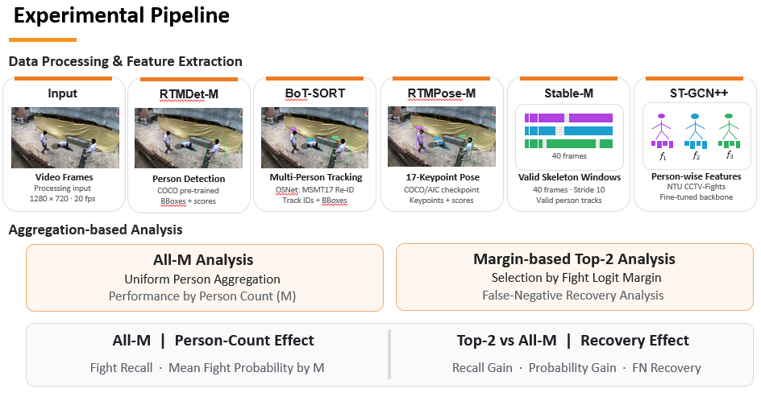
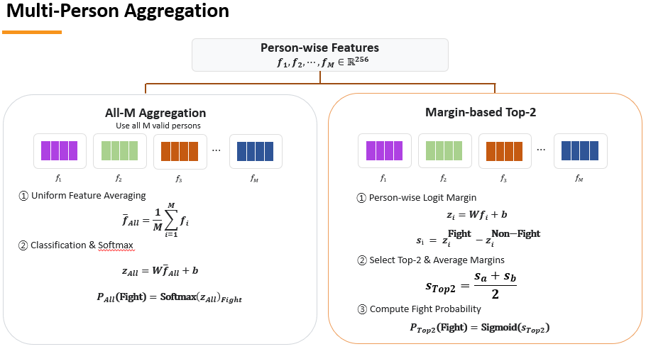
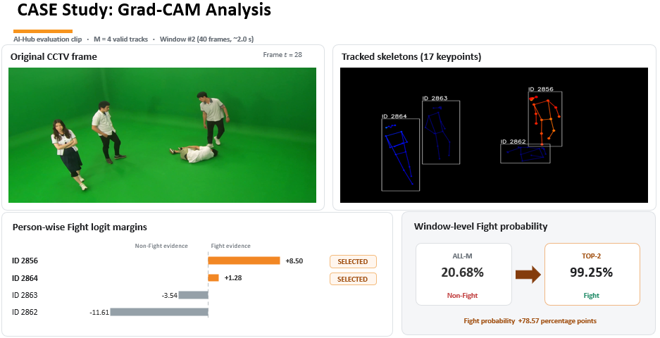

# Analysis of Multi-Person Aggregation Effects in Skeleton-Based Violence Recognition

SCIS & ISIS 2026 | Late-Breaking Paper

## Overview

This repository contains the experimental code for analyzing multi-person aggregation in skeleton-based violence recognition using ST-GCN++.

In real-world surveillance videos, violence scenes may contain both fight participants and non-participating bystanders. This study investigates how uniform person-wise feature aggregation affects violence recognition and examines the potential dilution of Fight evidence through Margin-based Top-2 Analysis.

## Methodology

### Experimental Pipeline

  

The pipeline consists of person detection (RTMDet), multi-person tracking (BoT-SORT with OSNet), pose estimation (RTMPose), Stable-M window construction, and ST-GCN++ inference.

ST-GCN++ was fine-tuned on NTU CCTV-Fights and evaluated on the AI-Hub Abnormal Behavior CCTV Video Dataset.

### Multi-Person Aggregation

  

- All-M: Uniform aggregation of all valid person features.
- Margin-based Top-2: Aggregation of the two persons with the highest Fight logit margins.

The Fight logit margin is defined as:

$$
s_i = z_i^{Fight} - z_i^{NonFight}
$$

## Results
The main analysis was conducted on 8,282 Stable-M windows containing two to four valid person tracks.

| Persons (M) | Windows | All-M Recall | Top-2 Recall | FN Recovery |
|---|---|---|---|---|
| 2 | 5,215 | 61.13% | 61.13% | 0.00% |
| 3 | 2,445 | 54.85% | 74.27% | 43.03% |
| 4 | 622 | 49.68% | 78.62% | 57.51% |

### Case Study & Grad-CAM

  

In a representative M = 4 false-negative case, the Fight probability increased from 0.207 (All-M) to 0.993 (Top-2).

Joint-level and temporal Grad-CAM illustrate how person-wise Fight evidence differs within the same window.

Margin-based Top-2 is an analytical tool rather than a deployable person selection method. The evaluation is limited to Fight samples.

## Installation
The experimental environment uses PyTorch 2.7.1 with CUDA 12.8 and OpenMMLab.

Install the project dependencies listed in requirements.txt.

Pre-trained checkpoints should be obtained from the official model repositories. The fine-tuned ST-GCN++ checkpoint is included in checkpoints/.

## Usage
Configure the dataset paths, checkpoint paths, and experimental parameters in src/config/base_cfg.yaml.

The experimental scripts are located in src/.

| Script | Description |
|---|---|
| `pipeline.py` | Person detection, tracking, and pose estimation |
| `gcn_inference.py` | Stable-M window construction and ST-GCN++ inference |
| `analyze_gcn.py` | All-M aggregation analysis |
| `analyze_top2.py` | Margin-based Top-2 analysis |
| `analyze_case.py` | Case analysis and Grad-CAM visualization |